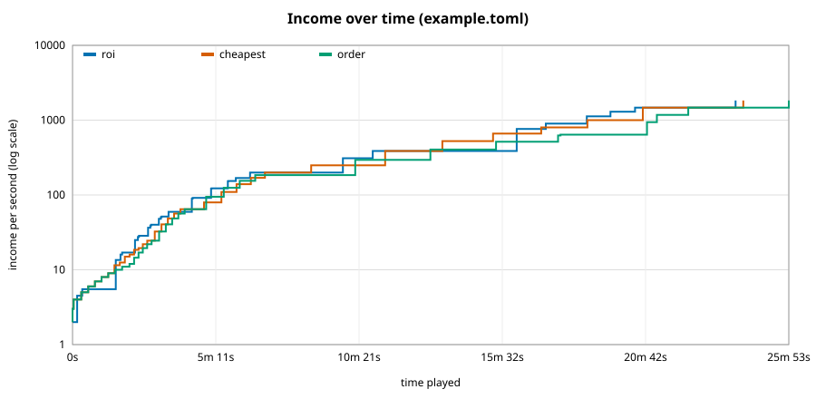

# rbxecon

Simulate the economy of a Roblox tycoon **before** you ship it, then export the exact same numbers to Luau.

You describe your items (price, income, price growth, requirements, multipliers) in one TOML file. `rbxecon` plays the game for you with three kinds of player and tells you:

- how long it takes to buy everything,
- where the player waits too long (**dead zones**),
- whether your **pacing targets** are met ("the Sauna should arrive around minute 20").

Then `rbxecon luau` writes an `Economy.luau` module, so the game and the simulation never drift apart.

Zero dependencies. Python 3.12+. MIT license.



## Install

```bash
git clone https://github.com/anthonigarss-coder/rbxecon
cd rbxecon
uv sync          # or: pip install .
uv run rbxecon init economy.toml
```

## Use

```bash
rbxecon init economy.toml          # write an example config
rbxecon check economy.toml         # find mistakes in the config
rbxecon sim economy.toml           # simulate (all strategies)
rbxecon sim economy.toml -s roi --timeline 20
rbxecon sim economy.toml --json --csv run.csv --svg chart.svg
rbxecon luau economy.toml -o Economy.luau
```

Exit codes: `0` ok, `1` a target was missed or the config has errors, `2` bad input (missing file, broken TOML, invalid config).

### Players (strategies)

| name | behaviour |
|---|---|
| `roi` | buys what pays itself back fastest (an optimizing player), looks one step ahead for items that unlock others |
| `cheapest` | always buys the cheapest thing available |
| `order` | buys in the order of the config file (a player who follows your intended path) |

A real player is somewhere between `roi` and `cheapest`. If all three reach your targets, your pacing is robust.

### Config

```toml
[economy]
start_cash  = 100
base_income = 2
round_costs = true      # same rounding as math.floor(x + 0.5)

[analysis]
max_wait_minutes = 3    # longer wait = dead zone

[[item]]
name = "Treadmill"
cost = 50               # first copy
cost_growth = 1.15      # copy n costs cost * growth^owned
max = 10
income = 1              # per second, per copy
group = "machines"

[[item]]
name = "Bench"
cost = 400
income = 8
requires = [{ item = "Dumbbell Rack", count = 1 }]

[[item]]
name = "Marketing Campaign"
kind = "multiplier"
multiplier = 1.25       # stacks: 1.25 ^ copies
applies_to = "machines" # omit = applies to all income
cost = 20000

[[target]]
item = "Sauna"          # or "*" = everything bought
minutes = 20
tolerance = 0.25        # +/- 25%
```

`rbxecon check` reports problems such as unknown requirements, requirement cycles, a player who cannot earn anything at the start, multipliers that do nothing, and targets pointing at missing items.

### Luau export

```lua
local Economy = require(ReplicatedStorage.Economy)

Economy.getCost("Treadmill", 3)          --> price of the next copy when 3 are owned
Economy.isUnlocked("Bench", owned)       --> requirements met?
Economy.incomePerSecond(owned)           --> groups + multipliers
```

`owned` is a table `{ [itemName] = count }`. Change the TOML, run `rbxecon luau` again, and the game uses the new numbers.

Note: the generated Luau is covered by tests on its text only. It was not run in a Luau runtime by the author. Run the check below once in Studio's command bar to confirm on your side.

```lua
local E = require(game.ReplicatedStorage.Economy)
print(E.getCost("Treadmill", 3))   -- the example config gives 76
print(E.getCost("Bench", 2))       -- 557
print(E.incomePerSecond({ Treadmill = 2, ["Dumbbell Rack"] = 1, ["Marketing Campaign"] = 1, ["Juice Bar"] = 1 }))  -- 26.875 with the example config
```

## How it works

Income only changes when you buy something. So the simulator jumps from purchase to purchase instead of ticking every second: a 24-hour game runs in milliseconds, and a 60-item economy in about 2 seconds.

## Tests

```bash
uv run pytest
```

## License

MIT
